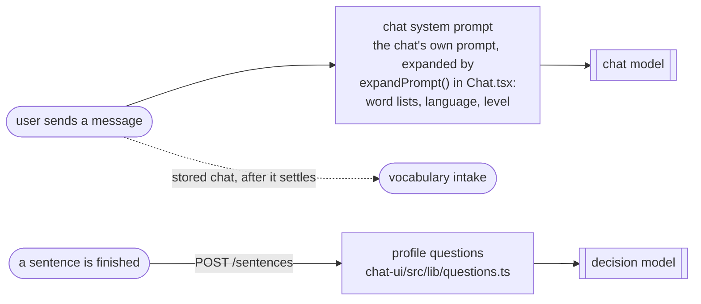
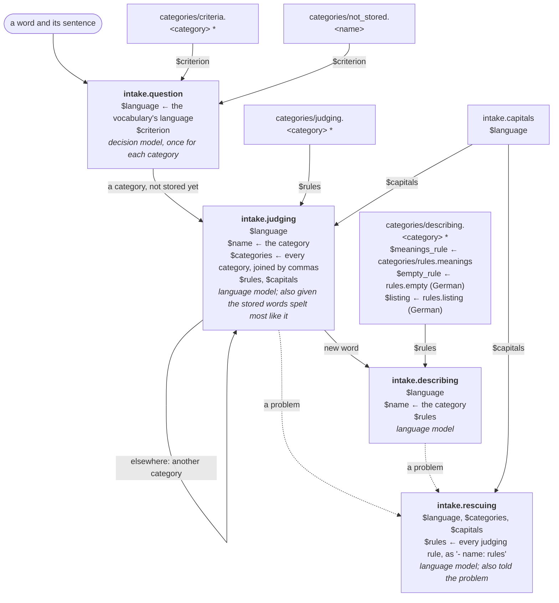
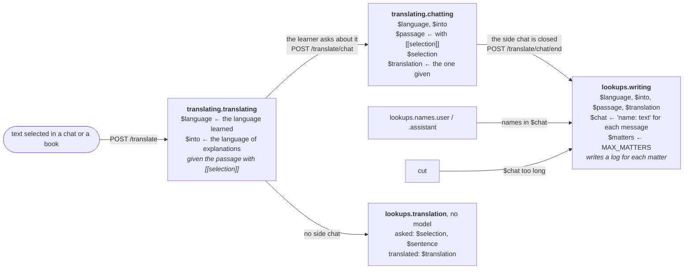
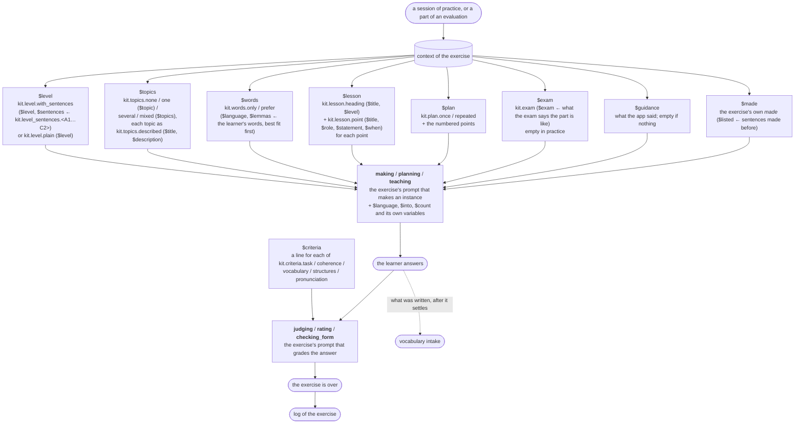
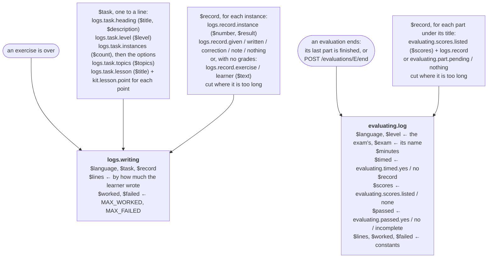
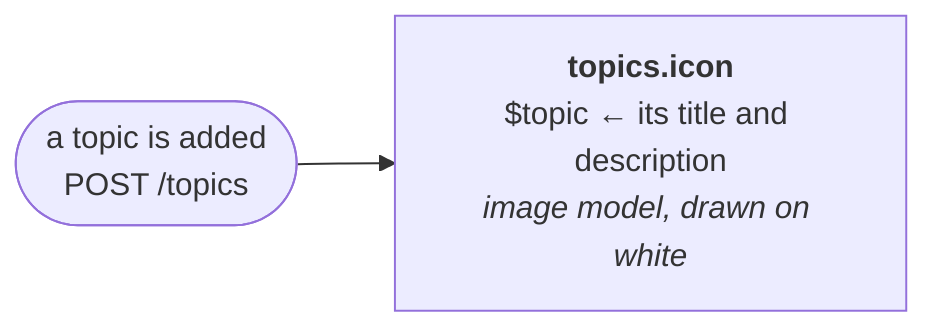

# How the prompts are used

What makes the server ask a model, which prompt it is told, and what fills
each of the prompt's `$variables`. The prompts are in `prompts/` (as
`prompts.py` describes), those of an exercise in the `prompts.toml` of its
directory in `exercises/`; a file in `languages/<language>/prompts/` stands
for the one of the same name in `prompts/` (marked `*`).

A box is a prompt sent to a model; a line into it, a smaller prompt or a
value that fills one of its variables.

## Chatting

The chat goes from the browser to OpenRouter and does not pass through
`prompts/`.

## Vocabulary intake

Run by the processor on chats and on what was written in exercises once
they have settled, and at once by `POST /vocabulary/words` and
`POST /vocabulary/selection`. Each word goes through these steps.

## Translating a selection

## An exercise

An exercise is run in a process of its own. `exercises/kit.py` makes the
pieces that the exercise's prompts are filled with from what the session
tells it (its context); what an exercise asks of a model is in its
`prompts.toml`.

The variables of each exercise's prompts:

| Exercise | Prompt | Variables |
| --- | --- | --- |
| cloze | making | count guidance into language lesson level made plan topics words |
| comprehension | making | answers by count exam guidance heard kind language length lesson level made topics words |
| | made | listed |
| oral | making | count exam guidance language level made task topics words |
| | rating | card criteria into language level shape turns |
| | turn | answer number prompt |
| | made | listed |
| picture | planning | avoid count guidance language level topics words |
| | drawing | scene things |
| | locating | things |
| | judging | into labels language level |
| | label | given number thing |
| | words | lemmas |
| | avoid.scenes / avoid.drawn | scenes / drawn |
| stories | making | asking guidance language length lesson level made shape topics words |
| | asking | count language |
| | judging_answers | answers into language level story |
| | judging_retelling | into language level retelling story |
| | answer | answer given number question |
| | made | listed |
| theory | teaching | into language lesson level pages |
| | question | page pages question |
| translation | making | count guidance into language lesson level made topics words |
| | judging | into language lesson level sentences |
| | sentence | given into number reference source |
| writing | making | count exam guidance kind language lesson level made topics words |
| | making_form | count exam guidance language level made topics |
| | rating | count criteria into language level points shape situation text written |
| | checking_form | fields into language text |
| | field | answer given label number |

## Logs of exercises and evaluations

## Topics

